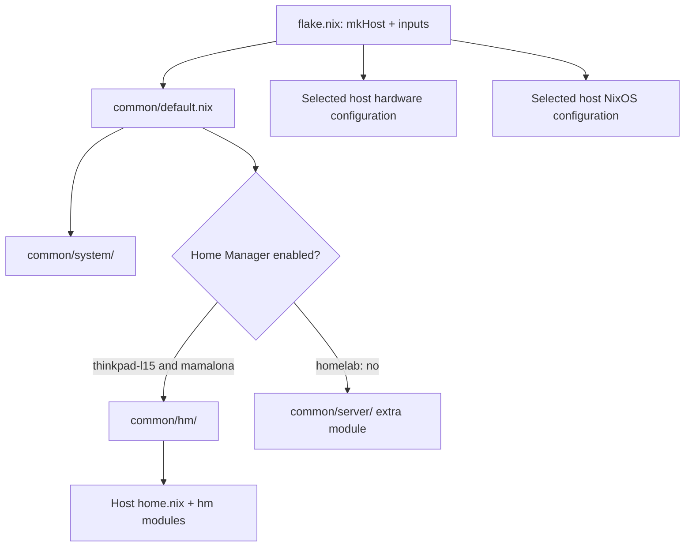

# NixOS Configuration

This flake manages three `x86_64-linux` NixOS configurations. `thinkpad-l15` and `mamalona` share a Home Manager desktop based on Hyprland and Illogical Impulse; `homelab` is a headless server template that opts out of Home Manager.

See [Architecture](docs/ARCHITECTURE.md) for the module graph and host-specific details, and [AGENTS.md](AGENTS.md) for repository-specific contributor and AI-agent rules.

## Features

- Multi-host NixOS configuration assembled by one `mkHost` function.
- Shared system modules plus explicit per-host hardware, system, and desktop settings.
- Home Manager package groups and application modules, including pinned AppImage wrappers and local Nix derivations.
- Illogical Impulse / Hyprland customization with shared and per-host Lua fragments.
- Kitty settings managed through Home Manager, including a generated quickshell theme include.
- Host-specific rebuild scripts, ThinkPad monitor helpers, and `mamalona` Windows VM tooling.
- Mamalona native-Linux Instant Replay via GPU Screen Recorder (`SUPER + ALT + F10` saves the last minute).
- A homelab-only server stack declaring AdGuard Home and Vaultwarden OCI containers.

## Supported machines

| Host | Flake target and entry point | Hardware / platform | Configuration notes |
|---|---|---|---|
| `thinkpad-l15` | `.#nixosConfigurations.thinkpad-l15`; `hosts/thinkpad-l15/configuration.nix` | `x86_64-linux`, AMD CPU platform, NVMe/EFI hardware configuration | Removable EFI GRUB, zram and earlyoom, light Steam profile, internal/external monitor helpers. Home Manager configures the laptop's `eDP-1` monitor. |
| `mamalona` | `.#nixosConfigurations.mamalona`; `hosts/mamalona/configuration.nix` | `x86_64-linux`, AMD CPU, NVIDIA graphics, sc0710 capture-card module | systemd-boot, gaming, libvirt, and a Windows single-GPU VFIO specialisation; host-local storage and multi-monitor settings. The config comments identify the GPU as an RTX 4080 Super. |
| `homelab` | `.#nixosConfigurations.homelab`; `hosts/homelab/configuration.nix` | `x86_64-linux`; **template only**, planned small-form-factor server hardware has not been purchased | No Home Manager; adds `common/server/` for networking, SSH, and container services. Hardware, disk/boot assumptions, and SSH key are not deployment-ready. |

All three outputs evaluate as NixOS configurations, but the homelab hardware has not been verified or deployed. A successful evaluation is not evidence of hardware readiness.

## Repository structure

```text
.
├── flake.nix, flake.lock            # Inputs, userName, mkHost, outputs and pins
├── common/
│   ├── default.nix                  # Shared NixOS entry point and Home Manager wiring
│   ├── system/                      # Shared NixOS services and system options
│   ├── hm/                          # Shared Home Manager programs, packages and services
│   │   ├── programs/                # App modules, wrappers, Kitty, shell and editors
│   │   ├── packages/                # Categorized standard Nix packages
│   │   ├── services/                # User services (keyring, BluCast, sc0710 audio)
│   │   ├── confs/                   # Deployed Zen, btop, fastfetch and OpenCode configs
│   │   ├── variables.lua, appearance.lua
│   │   └── scripts/record.sh        # Repo-owned screen-recording helper
│   └── server/                      # Homelab-only headless/network/container modules
├── hosts/
│   ├── thinkpad-l15/                # Laptop NixOS/HM, monitor fragments and helpers
│   ├── mamalona/                    # Desktop NixOS/HM, VFIO, VM and monitor fragments
│   └── homelab/                     # Not-yet-deployed server template
├── packages/                       # Local derivations: Owly, Piik, OG Xbox Plymouth
├── assets/boot.webm                 # Tracked Plymouth source asset (do not redistribute)
├── rebuild-*.sh                     # Desktop-host switch scripts
├── common-rebuild-commands.sh       # Shared Hyprland reload post-step
└── docs/ARCHITECTURE.md             # Detailed configuration and dependency map
```

## Architecture and configuration flow

`flake.nix` defines `mkHost`, which combines `common/default.nix`, the selected host's hardware and configuration files, and optional hardware/extra modules. Shared NixOS settings come from `common/system/`. Desktop hosts also receive `common/hm/` followed by their host-specific `home.nix` and `hm/` modules. The homelab disables Home Manager and adds `common/server/`, which force-disables desktop services from the shared system layer.



The single account value is `userName = "juan_ma7u7"` in `flake.nix`. NixOS modules receive it through `specialArgs`; Home Manager modules should use `config.home.username` or `config.home.homeDirectory`.

## Prerequisites and installation status

For maintenance, use a NixOS environment with the `nix-command` and `flakes` experimental features enabled, access to the pinned flake inputs, and enough network/disk capacity for Nix builds. The shared system module enables those experimental features on installed systems.

The tracked Plymouth source `assets/boot.webm` is referenced relative to the flake root and copied into the Nix store as a derivation input. The checkout does not need to live at a specific absolute path. The asset is proprietary Microsoft media retained for local personal use; do not redistribute it.

This repository does not document a supported first-install procedure. Host hardware files and boot settings must match the actual machine before installation or deployment. In particular, `homelab` is a paused template with placeholder hardware values and an authorized-key placeholder; it must not be treated as a ready server install.

## Rebuild and maintenance workflow

Run desktop rebuild scripts from the repository root and verify the target host before running them.

| Script | Host | Action | Privileges | Important behavior |
|---|---|---|---|---|
| `./rebuild-thinkpad-l15.sh [-s]` | `thinkpad-l15` | `nixos-rebuild switch --flake .#thinkpad-l15`, then shared `hyprctl reload` helper | Uses `sudo` | Without `-s`, recursively deletes `*.nixbak` files under the invoking user's home. `-s` skips cleanup; it is not a dry run. `switch` activates and updates the boot default. |
| `./rebuild-mamalona.sh [-s]` | `mamalona` | `nixos-rebuild switch --flake .#mamalona`, then shared `hyprctl reload` helper | Uses `sudo` | Same cleanup and activation behavior as above. |
| `./common-rebuild-commands.sh "Mamalona"` | Current desktop session; called by both scripts | Reloads Hyprland with `hyprctl reload` | No active `sudo` | The argument is currently unused; notification lines are commented out. |
| `sh ./hosts/thinkpad-l15/enable-internal-monitor.sh` | `thinkpad-l15` | Enables `eDP-1` and `HDMI-A-1` for the running session | No `sudo` | Live monitor change, not a persistent config edit. |
| `sh ./hosts/thinkpad-l15/use-only-ext-monitor.sh` | `thinkpad-l15` | Disables `eDP-1` and enables `HDMI-A-1` | No `sudo` | Live monitor change, not a persistent config edit. |
| `./hosts/mamalona/vm/win11-vm1-singlegpu/play-xbox.sh` | `mamalona` | Stops desktop/audio processes, unbinds NVIDIA, loads VFIO, starts Windows VM | Uses multiple `sudo` commands | High-impact hardware/session operation; never use for validation. |
| `./hosts/mamalona/vm/win11-vm1-singlegpu/scripts/attach-multimedia.sh` | `mamalona` VM | Attaches USB devices to the Windows VM via `virsh` | Script does not call `sudo` | Requires libvirt access and changes VM device state. |
| `common/hm/scripts/record.sh` | Desktop user session | Recording helper deployed over the upstream Illogical Impulse script | User session | Handles recording flags and writes video files; deployed through Home Manager activation. |
| `hosts/mamalona/hm/default.nix` GPU Screen Recorder service | `mamalona` normal Hyprland session | Maintains a 60-second replay buffer with desktop audio | User session | `SUPER + ALT + F10` saves a clip to `~/Videos/Clips`; first use may prompt for Wayland screen-capture permission. Does not run in the Windows VFIO profile. |

Both rebuild scripts require the repository root as the working directory, have fixed host targets, and do not verify the current hostname or change directories. They lack fail-fast handling, so inspect the `nixos-rebuild` output and do not rely on the final script status alone. There is no homelab rebuild script.

To build the homelab system derivation without activating it (this does not make the template hardware-ready):

```sh
nix build --no-link .#nixosConfigurations.homelab.config.system.build.toplevel
```

This can download inputs and build many packages. `nix eval` evaluates options; `nix build` builds without activation; `nixos-rebuild test` temporarily activates a configuration; `nixos-rebuild switch` activates it and sets it as the boot default. `test` and `switch` both change system state and are not documentation-validation commands.

## Package and AppImage management

### Standard Nix packages

Add or remove shared desktop packages in the matching category under `common/hm/packages/` (for example `applications.nix`, `browsers.nix`, or `gaming.nix`; `browsers.nix` shows the standard-package plus flake-package pattern). `common/hm/packages/default.nix` imports the category modules. These packages do not apply to `homelab`, which has no Home Manager. Host-specific system packages belong in that host's NixOS modules; host-specific user packages belong in its `home.nix` or `hm/` modules.

`sidequest` is currently omitted from `common/hm/packages/gaming.nix`: the locked Nixpkgs revision marks `sidequest-0.10.42` insecure because it uses EOL Electron 29. No insecure-package exception was added.

Application modules and wrappers live in `common/hm/programs/` and are assembled by `common/hm/programs/default.nix`. Starship is configured by Illogical Impulse rather than a separate repository program module. Custom derivations are under `packages/` and are connected through package modules or NixOS modules.

### AppImages

Most active AppImage expressions in `common/hm/programs/` (for example `pencil.nix`, `orca-slicer.nix`, and `duckstation.nix`) declare a version, a source URL, and a fixed hash; then use `pkgs.appimageTools.wrapType2`, any required `extraPkgs`, an optional launcher wrapper, and an `xdg.desktopEntries` declaration. Some install a separately fetched icon or rename the versioned executable. Affinity uses a custom extracted AppImage and Wine/FHS environment; inspect the target expression rather than assuming every application has the same runtime needs.

To update one, verify the upstream release, URL, architecture, and hash; change source/version/hash together; preserve the runtime libraries, launcher environment, desktop entry, icon and MIME settings; then build/evaluate the target package to validate it. Nix may download the artifact during the build, but a build does not activate the system. Never remove integrity verification or execute an untrusted binary to diagnose it.

## Desktop customization

The active Hyprland base files are copied by the `illogical-flake` Home Manager activation step `copyIllogicalImpulseConfigs`. Repository-owned shared overrides are `common/hm/variables.lua` and `common/hm/appearance.lua`; host-specific monitor, keybind and startup fragments are in `hosts/<host>/hm/host/`. `hosts/<host>/hm/host.nix` applies these after the upstream copy: general/keybind Lua is appended, while host `execs.lua` is copied as a complete file. Edit these tracked sources, not generated files under `~/.config/hypr`.

`common/system/hyprland.nix` configures Hyprland, greetd/tuigreet and portals. Shared system audio is in `common/system/audio.nix`; Home Manager desktop services are under `common/hm/services/`. Review host GPU and VM settings when touching graphics/session behavior.

Kitty is configured in `common/hm/programs/kitty.nix`. The `kitty-theme.conf` include is generated by quickshell; `common/hm/illogical.nix` restores the Home Manager Kitty config after the upstream activation copy. The rebuild helper invokes `hyprctl reload`. The repository does not verify that every quickshell or session change becomes live from a reload; a new session may be required.

## Validation and troubleshooting

The following read-only host evaluations were verified from the repository root:

```sh
nix eval --raw .#nixosConfigurations.thinkpad-l15.config.networking.hostName
nix eval --raw .#nixosConfigurations.mamalona.config.networking.hostName
nix eval --raw .#nixosConfigurations.homelab.config.networking.hostName
nix eval --raw .#packages.x86_64-linux.og-xbox-plymouth.name
```

For a build-only host check, use:

```sh
nix build --no-link .#nixosConfigurations.mamalona.config.system.build.toplevel
```

Replace `mamalona` with the intended host when needed. Builds can fetch and compile substantial dependencies, consume disk/time, and do not activate the configuration. No project-specific test suite, flake `checks` output, or formatter config was found. An optional flake-level evaluation command is `nix flake check --no-build`; it was not run during this audit and is not a hardware or functional test. `nixfmt` and `shellcheck` were not installed during the audit; shell syntax checks can use `sh -n` or `bash -n` for scripts without running them. No dedicated Hyprland/Lua configuration checker is defined here.

Troubleshooting pointers (general suggestions, not a list of observed failures):

- Check the flake target and fixed script target before rebuilding.
- For Nix errors, start with the host `nix eval` command and the reported module/option; check option availability against the lockfile revision.
- For AppImage fetch/runtime errors, verify URL/version/hash, architecture, and the wrapper's runtime libraries.
- For desktop changes, ensure the tracked source was edited and Home Manager activation applied it; do not rely on edits to generated `~/.config` files.
- A successful evaluation or build cannot verify hardware, physical displays, audio, VM passthrough, remote access, or a first homelab deployment.

## Contributing and AI agents

Keep changes host-scoped, inspect imports before editing, use non-mutating checks first, and review the complete diff. See [AGENTS.md](AGENTS.md) for mandatory agent workflow, validation and security rules. Document path, host-ownership, command, and workflow changes in the relevant documentation.

Never run a rebuild/switch, reboot, or hardware-changing script without explicit authorization. Do not commit credentials or private keys. The homelab authorized-key entry is a placeholder that must be replaced before deployment; never put the real key in documentation.
