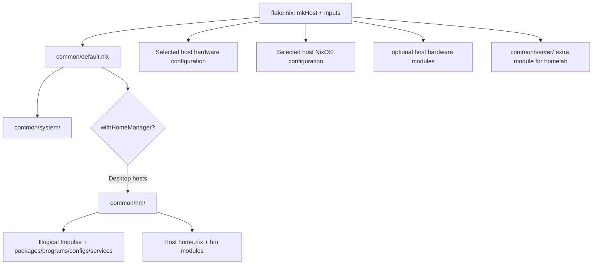

# Configuration Architecture

This document maps the current NixOS flake and its host-specific configuration. For day-to-day commands see the [README](../README.md); for change-safety requirements see the root [AGENTS.md](../AGENTS.md).

## Flake inputs and outputs

`flake.nix` declares these inputs:

| Input | Use in this repository |
|---|---|
| `nixpkgs` (`nixos-unstable`) | Primary package set and NixOS module library; exact revision is in `flake.lock`. |
| `nixpkgs-patchelf` (pinned Nixpkgs snapshot) | Supplies build-time `patchelf` 0.15.2 only for AnyDesk; the primary package set remains in use for its runtime dependencies. |
| `home-manager` | NixOS Home Manager module for the two desktop hosts. |
| `illogical-flake` | Illogical Impulse desktop/Home Manager modules and copied dotfiles, including Hyprland configuration; it also pins a nested QuickShell input. |
| `zen-browser` | Zen Browser package in `common/hm/packages/browsers.nix`. |
| `nixos-hardware` | Common CPU/PC/SSD/NVIDIA modules on desktop hosts. |
| `trinity-launcher` | Minecraft Bedrock launcher in `common/hm/packages/gaming.nix`. |
| `sc0710` | Elgato capture-card NixOS module on `mamalona`. |

The unused `nixarr` and `nix-index-database` inputs were removed after reference checks; `flake.lock` was pruned without updating the remaining input revisions.

The flake exposes `nixosConfigurations.{thinkpad-l15,mamalona,homelab}` and the standalone `packages.x86_64-linux.og-xbox-plymouth` output. Its system architecture is currently hardcoded to `x86_64-linux`. `userName = "juan_ma7u7"` is declared once in `flake.nix` and passed to the modules through `specialArgs`; Home Manager modules should derive user paths from Home Manager config. The system and desktop Home Manager `stateVersion` values are both `25.05`.

## Host assembly and shared layers

`mkHost` constructs each `lib.nixosSystem` with this module set:

1. `common/default.nix`
2. `hosts/<host>/hardware-configuration.nix`
3. `hosts/<host>/configuration.nix`
4. Optional upstream hardware modules and extra modules declared for that host.

`common/default.nix` sets the hostname from the `hostName` special argument and imports `common/system/`. It enables the Home Manager NixOS module for hosts where `withHomeManager` is true (the default). The shared Home Manager user imports, in order, `common/hm/`, `hosts/<host>/home.nix`, and `hosts/<host>/hm/`; extra arguments include the flake inputs, hostname, username, and the package-set aliases.

The desktop Home Manager layer (`common/hm/default.nix`) imports Illogical Impulse, shared program modules, categorized package modules, deployed config files, and user services. The headless host sets `withHomeManager = false` and adds `common/server/` instead. `common/server/server-base.nix` force-disables desktop facilities that the shared system layer enables; `common/server/networking.nix` sets the server network/firewall policy; `common/server/services/` declares AdGuard Home and Vaultwarden OCI containers.

The homelab service definitions are templates, not evidence of deployed services:

| Module | Declared ports | Persistence and status |
|---|---|---|
| `common/server/services/adguard.nix` | TCP/UDP 53, TCP 3000 and 80 | Bind mounts under `/var/lib/homelab/services/adguard/`; image tag is `latest`. |
| `common/server/services/vaultwarden.nix` | Host TCP 8222 to container port 80 | Bind mount under `/var/lib/homelab/services/vaultwarden/`; `SIGNUPS_ALLOWED` is currently `true` for first-run setup, and the file instructs disabling signups after account creation. Its comments warn not to expose the service directly to the Internet. |

`common/server/networking.nix` configures systemd-networkd DHCP, Tailscale, forwarding, a firewall allow-list, and trusts the `tailscale0` interface. Validate actual firewall reachability only on an authorized, deployed host; the template's network behavior is not hardware-tested.



## Host responsibilities

| Host | Shared configuration | Host-specific configuration | Notable boundary |
|---|---|---|---|
| `thinkpad-l15` | `common/system/` and Home Manager desktop layer | `hosts/thinkpad-l15/configuration.nix`, generated hardware file, `home.nix`, `hm/host.nix`, Lua monitor/keybind/exec fragments | AMD platform; GRUB EFI removable installation; laptop monitor `eDP-1`; zram and earlyoom; light Steam profile. External display helper scripts live in the host directory. |
| `mamalona` | `common/system/` and Home Manager desktop layer | `hosts/mamalona/configuration.nix`, `system.nix`, `vfio.nix`, `virt.nix`, `home.nix`, `hm/host.nix`, Lua fragments, and `vm/win11-vm1-singlegpu/` | AMD CPU with NVIDIA driver/GPU (host comments identify RTX 4080 Super), sc0710 capture card, multi-monitor layout, gaming, NTFS mounts, libvirt and Windows single-GPU VFIO specialisation. NVIDIA session variables and capture-card Home Manager services are host-local. |
| `homelab` | `common/system/` plus server overrides | `hosts/homelab/configuration.nix` and `hardware-configuration.nix`; `common/server/` is added by the flake | Not yet deployed: the owner says hardware is not purchased and the host files are templates. No Home Manager. The authorized SSH key is a placeholder that must be replaced before deployment. The GRUB device and filesystem label are template assumptions, not verified hardware. |

### Shared system modules

`common/system/default.nix` imports:

- `hyprland.nix`: Hyprland, greetd/tuigreet, NetworkManager, geoclue, and portals.
- `audio.nix`: PipeWire/WirePlumber, RTKit, ALSA persistence, and Logitech G733 handling.
- `plymouth.nix`: the tracked OG Xbox video theme and best-effort boot-audio service.
- `keyring.nix`: gnome-keyring daemon/PAM integration.
- `openrgb.nix`, `owly.nix`, `fonts.nix`, and `upstream-compat.nix`.

The same common module also defines time zone, garbage collection, firewall defaults, Bluetooth/gamepad support, Docker, Tailscale, printing, Flatpak, nix-ld, the shared account and system packages. `common/server/` changes the effective options for the headless profile with forced overrides. Review both layers when changing an option shared by desktops and server.

The NixOS `programs.hyprland` module enables the portal service and contributes the Hyprland and GTK implementations. Do not add those same packages again to `xdg.portal.extraPortals`: duplicate entries produce duplicate systemd user-unit links and fail the `user-units` build.

### Desktop configuration ownership

Hyprland's main configuration is not a `home.file` tree in this repo. The `illogical-flake` Home Manager module copies its own `dots/.config/hypr` during the `copyIllogicalImpulseConfigs` activation step. Repository customizations are sources:

- Shared: `common/hm/variables.lua`, `common/hm/appearance.lua`, and `common/hm/scripts/record.sh`.
- Per host: `hosts/<host>/hm/host/monitors.lua`, `keybinds.lua`, and `execs.lua`.
- Ordering/deployment: `common/hm/illogical.nix` and `hosts/<host>/hm/host.nix` run activation hooks after the upstream copy. General/keybind fragments are appended; host `execs.lua` is copied as a complete file.

Editing deployed `~/.config/hypr` files is not durable: activation replaces the upstream tree and re-applies the repository fragments. The old vendored Hyprland files under `common/hm/confs/` were removed because they were not part of the active config flow.

Kitty is configured through `common/hm/programs/kitty.nix`. Its `include` points to quickshell's generated `kitty-theme.conf`; the theme file is generated at runtime. Illogical Impulse's activation can wipe the Kitty directory, so `restoreHmManagedConfigs` reapplies the Home Manager-generated file afterward.

Starship's program and prompt configuration are owned by Illogical Impulse through `programs.illogical-impulse.dotfiles.starship`; there is no separate repository Starship module.

Other desktop integrations include system-level Hyprland portals and greetd, shared PipeWire/WirePlumber, the host-specific `mamalona` NVIDIA/VFIO configuration, and Home Manager services in `common/hm/services/` (BluCast, sc0710 audio, keyring). Changes to any of these should be reviewed alongside related desktop behavior.

The keyring setup is split across `common/system/keyring.nix` and `common/hm/services/keyring.nix`. The HM user service creates an empty, passwordless default collection only when no collection exists; an existing collection, including a locked one, is left untouched. This addresses the current greetd/PAM session behavior for applications using Secret Service.

## Package and application management

### Standard Nix packages

`common/hm/packages/default.nix` imports category files such as `applications.nix`, `browsers.nix`, `gaming.nix`, `media.nix`, and `wayland.nix`. These are shared by desktop Home Manager users, not by `homelab`. Host-only system packages belong in the appropriate host module; host-only HM packages belong in that host's `home.nix` or HM module.

Some package modules use `pkgs`, `pkgs-edge`, and `pkgs-locked`. The aliases are separately passed by `common/default.nix`; they do not imply that `pkgs-edge` follows an independent flake input. Check the actual import before changing a package source.

AnyDesk is managed by `common/hm/programs/anydesk.nix`. It pins the official 8.1.0 `amd64.tar.gz` source and fixed hash, while reusing the Nixpkgs AnyDesk derivation for dependencies, wrappers, icons, and desktop integration. Its `postFixup` uses `patchelf` 0.15.2 from the pinned `nixpkgs-patchelf` input. In testing, Nixpkgs' `patchelf` 0.19.2 produced an AnyDesk executable that segfaulted in glibc's dynamic loader, while 0.15.2 patched the same source successfully. This compatibility pin is build-time-only and should be removed once the primary package/toolchain no longer reproduces the loader crash.

`sidequest` is currently not installed through `common/hm/packages/gaming.nix`: the locked Nixpkgs revision marks version `0.10.42` insecure due to its EOL Electron 29 runtime. The configuration does not permit that package as an insecure exception.

### AppImages and other fetched binaries

Nix expressions for individual applications live in `common/hm/programs/`. Active AppImage examples include Pen (`pencil.nix`), Affinity, DuckStation, OrcaSlicer, Responsively, Motrix, ComfyUI, Locally Uncensored, Quiver Launcher, Pinokio, and Xodus Nexus. Their modules typically pin a version, source URL, and hash, then use `appimageTools.wrapType2`, a wrapper/runtime library list, an icon install, and a desktop entry. Affinity has a more specialized extraction and Wine/FHS wrapper; not every binary package is an AppImage.

For an update, verify the upstream release and CPU architecture; change the URL/version and fixed hash together; preserve required runtime libraries, wrappers, icons, desktop metadata, and launch flags; then build the specific derivation to validate it. The build fetches the artifact but does not activate the OS. Do not weaken a hash or run an untrusted downloaded binary.

Pen is enabled through `pencil.nix` and pins a versioned official GitHub release asset with a fixed SHA-256. When updating it, keep the version, release URL, and hash aligned; do not remove integrity validation. Xodus Gaming's separate CLI module and source input have been removed; Xodus Nexus remains a distinct active module.

Custom derivations live in `packages/`: `owly` and `piik` are binary archive packages with wrapper/runtime setup; `og-xbox-plymouth` extracts frames/audio from the local video input. Other application modules use archives, custom FHS environments, Wine, or non-flake sources; inspect the individual expression rather than assuming all applications follow the AppImage pattern.

## Scripts and operational workflows

All rebuild commands below assume the repository root as the current directory. The system scripts have fixed host targets; inspect the target before running. The tracked Plymouth source is referenced relative to the flake root, so `--impure` is not required for it.

| Script | Target | Purpose and action | Privileges / warnings |
|---|---|---|---|
| `./rebuild-thinkpad-l15.sh [-s]` | `thinkpad-l15` | Runs `nixos-rebuild switch --flake .#thinkpad-l15`; after it returns, calls the shared Hyprland reload helper. | Uses `sudo`. Without `-s`, deletes `*.nixbak` files recursively under the invoking user's home first. `-s` skips only that deletion; it is not a dry run. Switch activates the system and updates the boot default. |
| `./rebuild-mamalona.sh [-s]` | `mamalona` | Runs `nixos-rebuild switch --flake .#mamalona`; after it returns, calls the shared Hyprland reload helper. | Same cleanup and activation warnings as above. |
| `./common-rebuild-commands.sh "Mamalona"` (normally called by the rebuild scripts) | Current graphical session | Runs `hyprctl reload`; the display-name argument is currently unused because notification lines are commented out. | No sudo in active code. Requires a reachable Hyprland session. |
| `./hosts/thinkpad-l15/enable-internal-monitor.sh` | `thinkpad-l15` session | Enables `eDP-1` and `HDMI-A-1` using `hyprctl keyword monitor`. | No sudo; changes the current session's monitor layout. |
| `./hosts/thinkpad-l15/use-only-ext-monitor.sh` | `thinkpad-l15` session | Disables `eDP-1` and enables `HDMI-A-1`. | No sudo; changes the current session's monitor layout. |
| `./hosts/mamalona/vm/win11-vm1-singlegpu/play-xbox.sh` | `mamalona` | Stops the display manager/audio processes, unbinds NVIDIA devices, loads VFIO, then starts the Windows VM. | Uses multiple `sudo` commands and changes live device/desktop state. High impact; do not use as a validation command. |
| `./hosts/mamalona/vm/win11-vm1-singlegpu/scripts/attach-multimedia.sh` | `mamalona` Windows VM | Attaches three USB devices to the VM using `virsh attach-device`. | No `sudo` in the script; requires libvirt access. Changes VM device state. |
| `common/hm/scripts/record.sh` | Desktop session | Repository-owned screen recording helper deployed over the upstream script; handles `--fullscreen`, `--sound`, and `--region <geometry>`. | Runs in the logged-in desktop session and writes recordings under the configured/default recordings directory. It is deployed by HM activation, not a system rebuild script. |

The rebuild scripts do not verify the machine's current hostname or change to the repository directory. They also lack fail-fast handling: the helper may run even if `nixos-rebuild` fails, so inspect the rebuild output rather than treating the final script status as proof of success. There is no `homelab` rebuild script. The host is a template and must not be activated before hardware files and the SSH key are made real.

For a build-only evaluation of a host without activation:

```sh
nix build --no-link .#nixosConfigurations.mamalona.config.system.build.toplevel
```

Replace `mamalona` with the intended concrete host output when needed. The command builds without activating the system.

It may download inputs and build many packages. `nixos-rebuild test` temporarily activates a configuration; it still changes the running system. `nixos-rebuild switch` activates it and makes it the boot default. Neither activation command is part of documentation validation.

## Operational and security-sensitive behavior

These are observed configuration facts and should be reviewed before any separate security or behavior change:

- `hosts/mamalona/virt.nix` configures QEMU VNC to listen on `0.0.0.0` with VNC TLS disabled; TCP 5900 is allowed by shared/host firewall settings. Treat VNC exposure as a consequential existing setting.
- The BluCast runner in `common/hm/services/blucast.nix` tries a scoped `xhost +si:localuser:root` grant and then a broad `xhost +local` fallback. Do not broaden this access.
- `common/hm/programs/luban.nix` removes its Wine prefix with `rm -rf` each time the launcher runs; user state in that prefix is discarded.
- `hosts/mamalona/vm/win11-vm1-singlegpu/play-xbox.sh` stops desktop/audio processes and changes live GPU driver bindings. It is an operational action, not a test.
- The homelab SSH key remains a placeholder. Replace it with the owner's public key before any deployment; never put private key material in the repository.
- `assets/boot.webm` is tracked unfree Microsoft media retained for local personal use. Do not redistribute it.

The Plymouth expressions reference `assets/boot.webm` relative to the flake root. Nix includes this tracked file in the derivation input, so the repository can be checked out at any path and this asset does not require impure evaluation.

## Retained files with unclear consumers

- `hosts/mamalona/vm/win11-vm1-singlegpu/definition.xml` has no in-repository importer/reference found. Whether it is used manually to define the libvirt VM is unknown, so it was retained.
- `managed_context/metadata.json` and `test_suite_analysis/metadata.json` contain schema-version metadata and have no in-repository consumers found. Their external ownership/use is unknown, so they were retained pending confirmation.

## Validation boundary

The README documents verified host and package evaluation commands. Evaluation or a build can confirm Nix expressions and derivations, but cannot verify physical hardware, displays, audio devices, VFIO passthrough, network reachability, or a first homelab deployment. No custom test suite or flake `checks` output is defined in this repository.
